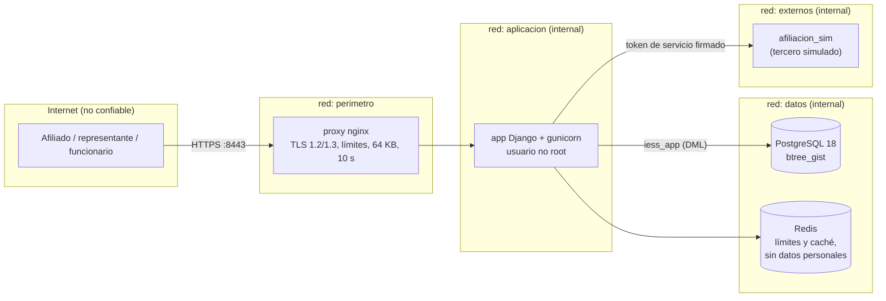
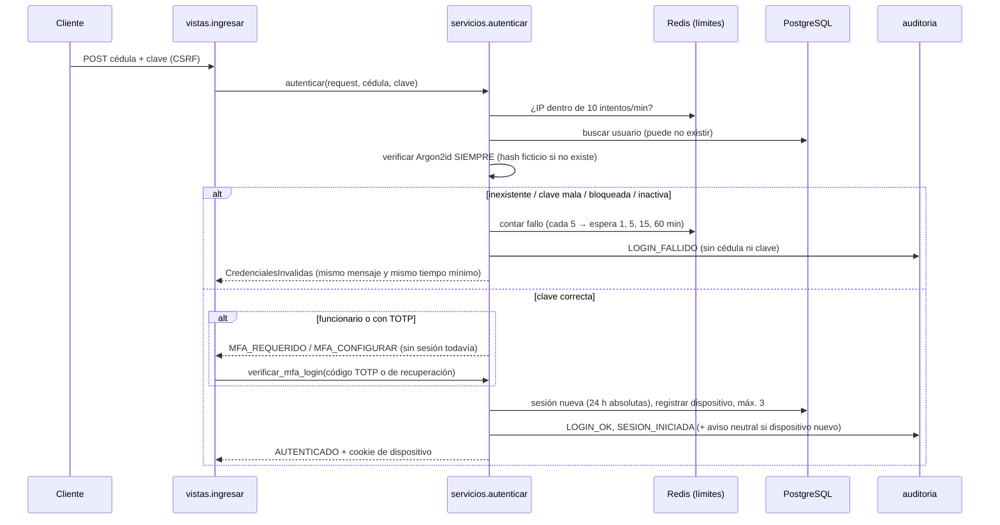
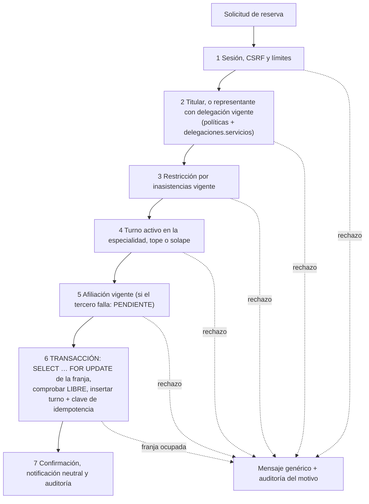

# Arquitectura del portal de turnos IESS (prototipo)

Documento de la **Etapa 1**. Fuente de verdad del diseño: `docs/informe.pdf`. Las reglas obligatorias para las
cuatro etapas están en `CLAUDE.md`; una prueba de arquitectura (`tests/arquitectura/`) hace que el repositorio falle
si alguna se rompe.

## 1. Por qué un monolito modular

| Criterio | Monolito modular por capas (elegido) | Microservicios |
|---|---|---|
| Transacciones | Una reserva toca franja, turno, idempotencia y auditoría en **una** transacción ACID; las restricciones únicas y de exclusión de PostgreSQL funcionan sin coordinación distribuida. | Exigirían sagas o consistencia eventual: justo lo que produce la "doble venta" de una franja (R13). |
| Superficie de ataque | Un proceso, una base, un perímetro. Menos puertos, menos credenciales entre servicios, menos cosas que parchear. | Más redes internas, más secretos y más código de autenticación entre servicios (R07, R17). |
| Equipo y alcance | Un equipo, prototipo local, cifras de capacidad modestas (≈ 200 solicitudes/s, §4.7). | Costo operativo sin beneficio con esa escala. |
| Evolución | Las apps (`cuentas`, `turnos`, …) tienen fronteras impuestas por pruebas: si mañana una debe separarse, ya solo se hablan por `servicios.py`. | — |

La modularidad no es decorativa: se **verifica**. `import-linter` y la inspección de AST fallan si una vista toca el ORM,
si una app importa los modelos de otra o si algo fuera de `auditoria` escribe en su tabla.

## 2. Zonas de confianza (Figura 3 del informe → Docker Compose)



* Solo el **proxy** publica puertos en el host (`8443` HTTPS y `8080`, que únicamente redirige). PostgreSQL, Redis, la
  aplicación y el servicio simulado **no** exponen puertos (lo comprueba `tests/seguridad/test_repositorio.py`).
* Las redes `aplicacion`, `datos` y `externos` son `internal: true`: sin salida a Internet.
* El proxy no está en las redes `datos` ni `externos`: no puede hablar con la base ni con terceros.
* El sistema clínico queda fuera del alcance (el portal gestiona turnos, no historia clínica).

### Roles de base de datos (mínimo privilegio, Anexo J)

| Rol | Uso | Puede | No puede |
|---|---|---|---|
| `iess_migraciones` | Solo el contenedor `migrar` | DDL (dueño del esquema), crear `btree_gist` | — |
| `iess_app` | La aplicación | SELECT/INSERT/UPDATE/DELETE; en `auditoria_evento` solo SELECT e INSERT | Crear/alterar/borrar tablas, extensiones, roles; UPDATE/DELETE/TRUNCATE en auditoría; conceder privilegios |
| `iess_auditoria_ro` | Revisión de auditoría | SELECT en `auditoria_evento` | Leer datos personales; escribir |
| `iess_pruebas` | **Solo desarrollo** | Crear la base temporal de las pruebas | — |

Además `iess_app` tiene `statement_timeout = 10s` (tiempo de solicitud del Anexo E). Autenticación SCRAM-SHA-256.

## 3. Capas dentro de cada app

```
  Cliente ──► proxy ──► [ 1. Vista fina ] ──► [ 2. Servicio de dominio ] ──► [ 3. Persistencia ]
                         autentica,            reglas RT-xx, transacción,     modelos + restricciones
                         valida esquema,       ÚNICO camino de escritura      de BD (únicos parciales,
                         llama a UN servicio   al ORM; usa políticas y        exclusión, CHECK)
                                               auditoría
```

Dependencias en **un solo sentido**: vista → servicio → modelo. Nunca al revés.

```
apps/<app>/
  modelos.py     persistencia (models.py es solo un reexport: Django exige ese nombre)
  servicios.py   reglas de negocio y escritura; API pública de la app
  politicas.py   (solo cuentas) autorización: funciones puras
  esquemas.py    validación de entrada (formularios)
  vistas.py      HTTP fino
  urls.py
  tests/
```

### Dirección de dependencias entre apps

```
turnos ──► delegaciones ──► cuentas ──► notificaciones, integraciones ──► auditoria
```

Una app **solo importa de otra su `servicios.py`** (y `cuentas.politicas` para autorizar). Las claves foráneas entre
apps se declaran con cadenas (`"cuentas.Usuario"`), sin importar el modelo. Código compartido sin estado de negocio:
`config/` (`parametros`, `reloj`, `contexto`, `limites`, `cedula`).

### Autorización centralizada (`cuentas/politicas.py`)

Funciones **puras** (sin ORM ni red) que **deniegan por defecto**: `puede_ver_turno(usuario, turno, *, delegacion_vigente,
relacion_asistencial)`, `nivel(usuario, permiso)` (la matriz de §4.3), `requiere_mfa`, `puede_gestionar_sesion`,
`sesion_apta_para_operacion_sensible`. Los hechos que requieren consultar la base (¿hay una delegación vigente?) los
resuelve el servicio llamador y se los pasa. Un mismo error (404) sirve para "no existe" y "no es suyo" (CA-07).

### Auditoría centralizada (`auditoria.servicios.registrar`)

Cadena de eventos de **solo adición**: cada fila lleva el hash del anterior y un **HMAC-SHA256** con una clave propia,
separada de `SECRET_KEY` y **versionada** (rotación sin romper la cadena). Un bloqueo consultivo de PostgreSQL serializa
a los escritores. La base rechaza UPDATE, DELETE y TRUNCATE (permisos + disparador). El detalle pasa por un filtro de
redacción (claves, tokens, códigos, cookies). `manage.py verificar_auditoria` recorre la cadena y falla si detecta una
alteración. IP y correlación salen del contexto de la solicitud: las vistas no auditan a mano.

### Integraciones como adaptadores

`integraciones/puertos.py` define la interfaz (`PuertoAfiliacion`); `servicios.py` es la fachada. El adaptador HTTP
(`adaptadores/http.py`) contiene tiempo de espera de 3 s, 2 reintentos con espera creciente, circuito abierto tras 5
fallos en 30 s, validación estricta del esquema de respuesta y autenticación con token de servicio firmado. Un fallo
**nunca** se interpreta como "no afiliado" ni como cobertura: lanza `ServicioNoDisponible` (la reserva quedará PENDIENTE,
RT-10). La mensajería sigue el mismo patrón (`notificaciones/adaptadores`: consola, archivo, memoria).

### Configuración

Todos los números de seguridad y de turnos del Anexo E viven en `config/parametros.py` (sobrescribibles con variables
`PARAM_*`). Los secretos solo en variables de entorno (`.env`, ignorado por git).

## 4. Flujo de un inicio de sesión



Detalles que importan: el bloqueo se lleva por **cédula aunque no exista** (así un bloqueo no delata cuentas reales);
el tiempo de respuesta se iguala con un piso (`tiempo_minimo_respuesta_auth_ms`); la sesión no se renueva con la
actividad (vencimiento absoluto) y se rota al autenticarse; las cookies usan el prefijo `__Host-`.

## 5. Flujo de una reserva (diseño; se implementa en la Etapa 2)

Orden de la Figura 2: lo barato y lo de seguridad primero, la transacción al final.



La base es la última línea de defensa: aunque el código fallara, el motor rechaza una segunda reserva activa
(`uq_turno_afiliado_especialidad`, RT-01), una franja ocupada (`uq_turno_franja`, RT-04), un solape de horario
(`ex_turno_sin_solape` con `btree_gist`, RT-03) y la repetición de una clave de idempotencia (`uq_idempotencia`).

## 6. Decisiones y desviaciones respecto del informe

| Tema | Decisión | Motivo |
|---|---|---|
| Turno activo | PENDIENTE, RESERVADO y CONFIRMADO | El SQL del informe (§3.6) solo menciona los dos últimos, pero un turno PENDIENTE ya ocupa la franja; si no contara, dos solicitudes simultáneas podrían crear dos turnos PENDIENTE para la misma franja o persona. |
| Vigencia del token de recuperación | 15 minutos | El Anexo E dice "24 horas" y el Anexo F "15 minutos"; se adopta el más estricto (coincide con la Etapa 1). |
| Segundo factor | TOTP propio con `pyotp` (sin `django-otp`) | Menos tablas y superficie; antirreutilización de códigos con actualización condicional; secreto cifrado con Fernet (rotación con `MultiFernet`). |
| Bloqueo por intentos | Implementación propia sobre Redis (sin `django-axes`) | Debe aplicar también a cédulas inexistentes y con escalones 1/5/15/60 min, que `django-axes` no ofrece nativamente. |
| Hash de la cadena de auditoría | HMAC-SHA256 con clave versionada (el informe dice "SHA-256 encadenado") | Un hash simple permitiría a quien edite la base recalcular toda la cadena; con HMAC necesita además la clave. |
| Estado del bloqueo de cuentas | En Redis (puede perderse si Redis se reinicia) | Redis es solo para límites y caché; la pérdida solo "perdona" intentos y no abre ninguna cuenta. |
| Rol `PROFESIONAL` | Incluido en el modelo y la matriz aunque la lista de siembra del prompt no lo nombra | Existe en el informe (§4.3); se siembra un profesional de demostración. |
| Fecha de nacimiento | Se consulta al servicio de afiliación al validar una clave y **no se guarda ni se cachea** | Se usa solo para rechazar claves biográficas (T03). |

## 7. Qué se simula y qué cambiaría en producción

Simulado en esta etapa: servicio de afiliación (contenedor `afiliacion_sim`), correo/SMS (consola o archivo), TLS
(certificado de desarrollo), secretos (variables de entorno). En producción: interfaces oficiales con mTLS, proveedor de
mensajería contratado, certificado de la institución, gestor de secretos, WAF y nodos redundantes (ver informe §10.3).
