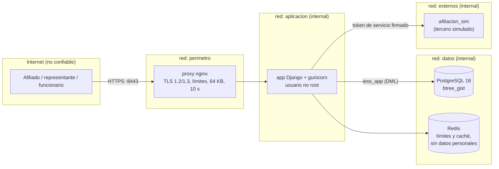
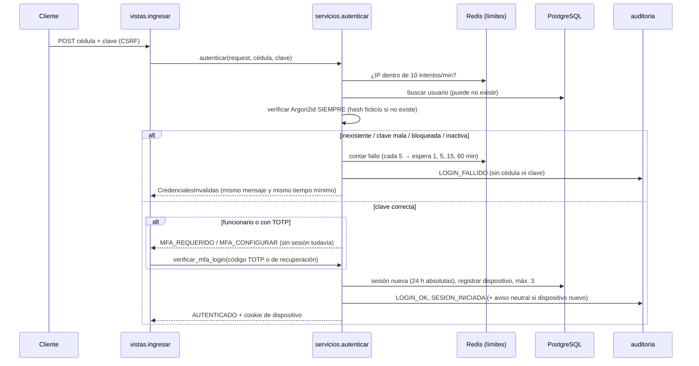
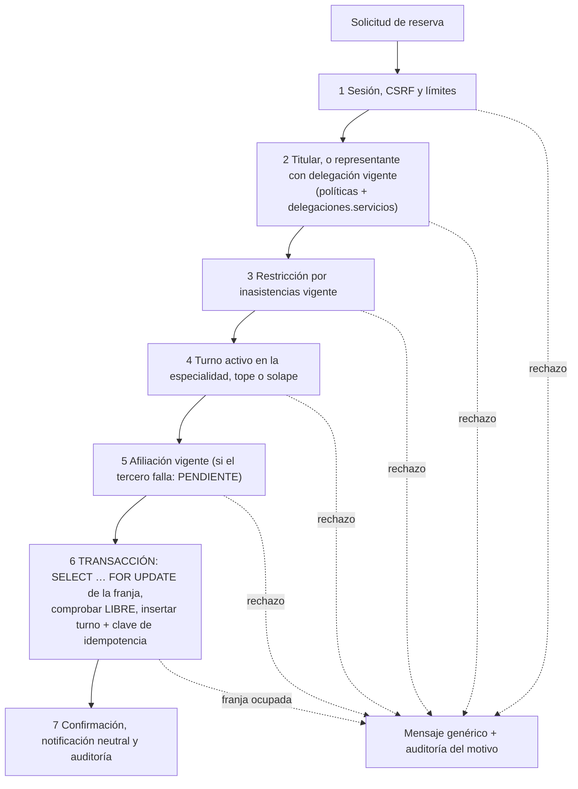

# Arquitectura del portal de turnos IESS (prototipo)

Documento de las **Etapas 1 y 2**. Fuente de verdad del diseño: `docs/informe.pdf`. Las reglas obligatorias para las
cuatro etapas están en `CLAUDE.md`; una prueba de arquitectura (`tests/arquitectura/`) hace que el repositorio falle
si alguna se rompe.

## 1. Por qué un monolito modular

| Criterio | Monolito modular por capas (elegido) | Microservicios |
|---|---|---|
| Transacciones | Una reserva toca franja, turno, idempotencia y auditoría en **una** transacción ACID; las restricciones únicas y de exclusión de PostgreSQL funcionan sin coordinación distribuida. | Exigirían sagas o consistencia eventual: justo lo que produce la "doble venta" de una franja (R13). |
| Superficie de ataque | Un proceso, una base, un perímetro. Menos puertos, menos credenciales entre servicios, menos cosas que parchear. | Más redes internas, más secretos y más código de autenticación entre servicios (R07, R17). |
| Equipo y alcance | Un equipo, prototipo local, cifras de capacidad modestas (≈ 200 solicitudes/s, §4.7). | Costo operativo sin beneficio con esa escala. |
| Evolución | Las apps (`cuentas`, `turnos`, …) tienen fronteras impuestas por pruebas: si mañana una debe separarse, ya solo se hablan por `servicios.py`. | — |

La modularidad no es decorativa: se **verifica**. `import-linter` y la inspección de AST fallan si una vista toca el ORM,
si una app importa los modelos de otra o si algo fuera de `auditoria` escribe en su tabla.

## 2. Zonas de confianza (Figura 3 del informe → Docker Compose)



* Solo el **proxy** publica puertos en el host (`8443` HTTPS y `8080`, que únicamente redirige). PostgreSQL, Redis, la
  aplicación y el servicio simulado **no** exponen puertos (lo comprueba `tests/seguridad/test_repositorio.py`).
* Las redes `aplicacion`, `datos` y `externos` son `internal: true`: sin salida a Internet.
* El proxy no está en las redes `datos` ni `externos`: no puede hablar con la base ni con terceros.
* El sistema clínico queda fuera del alcance (el portal gestiona turnos, no historia clínica).

### Roles de base de datos (mínimo privilegio, Anexo J)

| Rol | Uso | Puede | No puede |
|---|---|---|---|
| `iess_migraciones` | Solo el contenedor `migrar` | DDL (dueño del esquema), crear `btree_gist` | — |
| `iess_app` | La aplicación | SELECT/INSERT/UPDATE/DELETE; en `auditoria_evento` solo SELECT e INSERT | Crear/alterar/borrar tablas, extensiones, roles; UPDATE/DELETE/TRUNCATE en auditoría; conceder privilegios |
| `iess_auditoria_ro` | Revisión de auditoría | SELECT en `auditoria_evento` | Leer datos personales; escribir |
| `iess_pruebas` | **Solo desarrollo** | Crear la base temporal de las pruebas | — |

Además `iess_app` tiene `statement_timeout = 10s` (tiempo de solicitud del Anexo E). Autenticación SCRAM-SHA-256.

## 3. Capas dentro de cada app

```
  Cliente ──► proxy ──► [ 1. Vista fina ] ──► [ 2. Servicio de dominio ] ──► [ 3. Persistencia ]
                         autentica,            reglas RT-xx, transacción,     modelos + restricciones
                         valida esquema,       ÚNICO camino de escritura      de BD (únicos parciales,
                         llama a UN servicio   al ORM; usa políticas y        exclusión, CHECK)
                                               auditoría
```

Dependencias en **un solo sentido**: vista → servicio → modelo. Nunca al revés.

```
apps/<app>/
  modelos.py     persistencia (models.py es solo un reexport: Django exige ese nombre)
  servicios.py   reglas de negocio y escritura; API pública de la app
  politicas.py   (solo cuentas) autorización: funciones puras
  esquemas.py    validación de entrada (formularios)
  vistas.py      HTTP fino
  urls.py
  tests/
```

### Dirección de dependencias entre apps

```
turnos ──► delegaciones ──► cuentas ──► notificaciones, integraciones ──► auditoria
```

Una app **solo importa de otra su `servicios.py`** (y `cuentas.politicas` para autorizar). Las claves foráneas entre
apps se declaran con cadenas (`"cuentas.Usuario"`), sin importar el modelo. Código compartido sin estado de negocio:
`config/` (`parametros`, `reloj`, `contexto`, `limites`, `cedula`).

### Autorización centralizada (`cuentas/politicas.py`)

Funciones **puras** (sin ORM ni red) que **deniegan por defecto**: `puede_ver_turno(usuario, turno, *, delegacion_vigente,
relacion_asistencial)`, `nivel(usuario, permiso)` (la matriz de §4.3), `requiere_mfa`, `puede_gestionar_sesion`,
`sesion_apta_para_operacion_sensible`. Los hechos que requieren consultar la base (¿hay una delegación vigente?) los
resuelve el servicio llamador y se los pasa. Un mismo error (404) sirve para "no existe" y "no es suyo" (CA-07).

### Auditoría centralizada (`auditoria.servicios.registrar`)

Cadena de eventos de **solo adición**: cada fila lleva el hash del anterior y un **HMAC-SHA256** con una clave propia,
separada de `SECRET_KEY` y **versionada** (rotación sin romper la cadena). Un bloqueo consultivo de PostgreSQL serializa
a los escritores. La base rechaza UPDATE, DELETE y TRUNCATE (permisos + disparador). El detalle pasa por un filtro de
redacción (claves, tokens, códigos, cookies). `manage.py verificar_auditoria` recorre la cadena y falla si detecta una
alteración. IP y correlación salen del contexto de la solicitud: las vistas no auditan a mano.

### Integraciones como adaptadores

`integraciones/puertos.py` define la interfaz (`PuertoAfiliacion`); `servicios.py` es la fachada. El adaptador HTTP
(`adaptadores/http.py`) contiene tiempo de espera de 3 s, 2 reintentos con espera creciente, circuito abierto tras 5
fallos en 30 s, validación estricta del esquema de respuesta y autenticación con token de servicio firmado. Un fallo
**nunca** se interpreta como "no afiliado" ni como cobertura: lanza `ServicioNoDisponible` (la reserva quedará PENDIENTE,
RT-10). La mensajería sigue el mismo patrón (`notificaciones/adaptadores`: consola, archivo, memoria).

### Configuración

Todos los números de seguridad y de turnos del Anexo E viven en `config/parametros.py` (sobrescribibles con variables
`PARAM_*`). Los secretos solo en variables de entorno (`.env`, ignorado por git).

## 4. Flujo de un inicio de sesión



Detalles que importan: el bloqueo se lleva por **cédula aunque no exista** (así un bloqueo no delata cuentas reales);
el tiempo de respuesta se iguala con un piso (`tiempo_minimo_respuesta_auth_ms`); la sesión no se renueva con la
actividad (vencimiento absoluto) y se rota al autenticarse; las cookies usan el prefijo `__Host-`.

## 5. Flujo de una reserva (implementado en la Etapa 2: `turnos/servicios.py`)

Orden de la Figura 2: lo barato y lo de seguridad primero, la transacción al final.



La base es la última línea de defensa: aunque el código fallara, el motor rechaza una segunda reserva activa
(`uq_turno_afiliado_especialidad`, RT-01), una franja ocupada (`uq_turno_franja`, RT-04), un solape de horario
(`ex_turno_sin_solape` con `btree_gist`, RT-03) y la repetición de una clave de idempotencia (`uq_idempotencia`).

## 6. Decisiones y desviaciones respecto del informe

| Tema | Decisión | Motivo |
|---|---|---|
| Turno activo | PENDIENTE, RESERVADO y CONFIRMADO | El SQL del informe (§3.6) solo menciona los dos últimos, pero un turno PENDIENTE ya ocupa la franja; si no contara, dos solicitudes simultáneas podrían crear dos turnos PENDIENTE para la misma franja o persona. |
| Vigencia del token de recuperación | 15 minutos | El Anexo E dice "24 horas" y el Anexo F "15 minutos"; se adopta el más estricto (coincide con la Etapa 1). |
| Segundo factor | TOTP propio con `pyotp` (sin `django-otp`) | Menos tablas y superficie; antirreutilización de códigos con actualización condicional; secreto cifrado con Fernet (rotación con `MultiFernet`). |
| Bloqueo por intentos | Implementación propia sobre Redis (sin `django-axes`) | Debe aplicar también a cédulas inexistentes y con escalones 1/5/15/60 min, que `django-axes` no ofrece nativamente. |
| Hash de la cadena de auditoría | HMAC-SHA256 con clave versionada (el informe dice "SHA-256 encadenado") | Un hash simple permitiría a quien edite la base recalcular toda la cadena; con HMAC necesita además la clave. |
| Estado del bloqueo de cuentas | En Redis (puede perderse si Redis se reinicia) | Redis es solo para límites y caché; la pérdida solo "perdona" intentos y no abre ninguna cuenta. |
| Rol `PROFESIONAL` | Incluido en el modelo y la matriz aunque la lista de siembra del prompt no lo nombra | Existe en el informe (§4.3); se siembra un profesional de demostración. |
| Fecha de nacimiento | Se consulta al servicio de afiliación al validar una clave y **no se guarda ni se cachea** | Se usa solo para rechazar claves biográficas (T03). |

## 7. Qué se simula y qué cambiaría en producción

Simulado en esta etapa: servicio de afiliación (contenedor `afiliacion_sim`), correo/SMS (consola o archivo), TLS
(certificado de desarrollo), secretos (variables de entorno). En producción: interfaces oficiales con mTLS, proveedor de
mensajería contratado, certificado de la institución, gestor de secretos, WAF y nodos redundantes (ver informe §10.3).


## 8. Etapa 2: turnos, delegaciones, agenda y endpoints

### Máquina de estados del turno (Figura 1)

```
solicitud ─► PENDIENTE ──(la agenda confirma)──► RESERVADO ──(el afiliado confirma en 24 h)──► CONFIRMADO ──► ATENDIDO
                │  │                                │  │                                          │  ├──► NO_ASISTIO ──(justifica en 72 h)──► JUSTIFICADO
                │  └─(agenda rechaza / sin respuesta en 2 h)─► CANCELADO_INSTITUCION               │  └──► CANCELADO_AFILIADO (hasta 2 h antes)
                └─ afiliación o agenda caídas: SIGUE PENDIENTE, nunca se afirma cobertura (RT-10)   └─(24 h sin confirmar)──► EXPIRADO (libera el cupo)
```

* La reserva **no llama al tercero dentro de la transacción de la franja**: primero se confirma la reserva local
  (PENDIENTE, franja OCUPADA, clave de idempotencia) y *después* se pide a la agenda que confirme; así el bloqueo de
  la franja dura milisegundos y no depende de la latencia del tercero.
* **Tareas programadas** (servicio `tareas` de Compose, `manage.py ejecutar_tareas`): expiran los RESERVADO sin
  confirmar (RT-05, con aviso y cupo liberado) y concilian los PENDIENTE con la agenda (RT-10). Son idempotentes y
  usan `SELECT … FOR UPDATE SKIP LOCKED`, por lo que pueden correr en paralelo.
* **Concurrencia**: `tests/concurrencia` lanza 1 000 intentos reales con 50 hilos por la última franja: una venta,
  999 rechazos con código de negocio y ningún error inesperado (se repitió 3 veces; resultado estable).

### Política de inasistencias

Se **recalcula desde el historial** (`recalcular_restricciones`), no con contadores incrementales: 1+ inasistencia
injustificada en 90 días → tope de 1 turno activo; 2 consecutivas en una especialidad → bloqueo de esa especialidad 14
días; 3 en 90 días → revisión humana (auditoría, sin sanción automática); justificar en 72 h revierte; apelación
ante una persona de la unidad (5 días hábiles); los grupos de atención prioritaria quedan exentos y los cupos
reservados son solo suyos (RT-11). La atención presencial nunca depende de estas restricciones.

### Endpoints (Anexo D)

`config/inventario.py` es la **fuente**; `docs/endpoints.md` se genera de él (`manage.py generar_inventario`). Cada vista
lleva `@endpoint("E08")` (método, sesión y límites por IP y por cuenta) y las rutas con varios métodos usan `despachar`.
`tests/seguridad/test_inventario.py` falla si hay una ruta sin entrada o una entrada sin ruta, y una prueba de la prueba
demuestra que detecta una ruta de depuración agregada. Esquemas **estrictos** (`config/formularios.py`): campos
desconocidos → 400; el cliente no puede enviar estado ni propietario.

### Decisiones y desviaciones de la Etapa 2

| Tema | Decisión | Motivo |
|---|---|---|
| Rechazo de la agenda | El turno pasa a `CANCELADO_INSTITUCION` (la Figura 1 dibuja `CANCELADO_AFILIADO`) | El afiliado no canceló nada; atribuirle la cancelación sería engañoso y falsearía el historial. |
| Reprogramar | Reinicia la confirmación (PENDIENTE → RESERVADO, 24 h) | Un cupo nuevo debe confirmarlo la agenda y la persona. |
| Rutas de la Etapa 1 | E02-E05 pasan a `/cuentas/activar`, `/sesion`, `/sesion/segundo-factor`, `/sesion/cerrar`; el resto de pasos del Anexo F queda en `/cuenta/…` como *rutas de soporte* | El prompt pide los endpoints "exactamente como están". Revocar una sesión es ahora `POST /sesion/cerrar` con `alcance=una|todas`. |
| Rutas de soporte | `S01…S10` documentadas junto a E01-E21 | Pantallas y pasos del Anexo F que el Anexo D no numera; pasan por las mismas pruebas. |
| `/salud` | Sin barra final y bloqueada por el proxy fuera de `127.0.0.1` | E21 es "solo red interna". |
| E20 | GET que consume el token (como define el inventario) | Solo lleva a iniciar sesión y caduca; no abre datos. Un escáner de correo podría consumirlo: riesgo aceptado y documentado. |
| E18 | La cédula va en la ruta (Anexo D); el proxy enmascara la ruta en sus registros | Evita que las cédulas, los tokens y la justificación queden en los registros de acceso (R08). gunicorn ya no registra accesos. |
| Previsualizar al representante | También pide segundo factor reciente | Sin esto serviría para averiguar nombres por cédula (R18). |
| Conciliación | Reintenta confirmar los PENDIENTE; no compara listados completos con la agenda | Alcance del prototipo; la comparación masiva queda para producción. |

### Cambios a la Etapa 1 (ver también el resumen de la entrega)

Rutas renombradas (arriba); `cuentas.politicas` ampliada con las funciones de turnos/delegaciones/interno; catálogo de
acciones de auditoría ampliado; `servicios` de `cuentas` ahora exponen consultas de personas para otras apps;
**corrección de un error**: iniciar sesión estando ya autenticado en el mismo navegador daba un 500 (la sesión del mismo
dispositivo se revocaba y luego se intentaba guardar); ahora se descarta y se crea una nueva (prueba de regresión
`test_iniciar_sesion_estando_ya_autenticado…`).

## 9. Etapa 3: paneles, detección, derechos, respaldos y claves

**Apps y capas** (de arriba abajo): `derechos` > `turnos | deteccion` > `delegaciones` > `cuentas` > `notificaciones | integraciones` > `auditoria`.
`deteccion` solo lee la auditoría (`consultar_ventana`) y actúa mediante `config.bloqueos`, `config.metricas` y los servicios de `cuentas`;
nunca importa vistas (prueba de arquitectura). `ejecutar_tareas` vive en `derechos` porque orquesta capas altas. El archivo `.importlinter`
se **genera** con `scripts/generar_importlinter.py` y una prueba comprueba que está al día.

**Paneles** (rutas S11-S27 en `docs/endpoints.md`): soporte (ficha técnica enmascarada, solo inicia la recuperación hacia el contacto registrado),
oferta (jornadas y cierre de franjas, limitado a la unidad), alertas (D01-D18), derechos del titular y exportaciones puntuales con doble aprobación,
acceso excepcional de emergencia (motivo ≥ 20 caracteres, aviso inmediato, alerta D10 hasta revisión). No existe exportación masiva.

**Auditoría:** asientos de corrección (`proponer_correccion` → `aprobar_correccion` por un segundo supervisor); nunca se edita un asiento.
`verificar_auditoria` deja rastro si falla (D11). Rotación de clave versionada: ver `docs/claves.md`.

**Respuesta automática:** bloqueo de origen (403 + `Retry-After`, `/salud` exento), desafío adaptativo (suma firmada de un solo uso, solo cuando
la detección lo activa) y sala de espera (503 + `Retry-After`) cuando el p95 se degrada. Los límites por ruta/IP/cuenta/dispositivo viven en Redis.

**Retención y derechos:** tarea diaria `ejecutar_vencimiento` (24 meses de turnos, 12 de auditoría archivada/notificaciones/…, códigos 7 días)
con constancia por categoría; eliminación a petición con anonimización y órdenes a encargados simulados (aviso 3 días, eliminación 5).

### Respaldos y recuperación (Anexo I)

- PostgreSQL archiva WAL de forma continua (`archive_mode=on`, `archive_timeout=60`) en el volumen `wal_archivo`.
- `scripts/respaldo.sh` (diario) hace `pg_basebackup`, lo cifra con AES-256 (`RESPALDO_CLAVE`), lo guarda en el volumen `respaldos` y en `./respaldos_locales`
  (fuera de Docker), escribe un manifiesto con hash y registra `RESPALDO_REALIZADO`/`RESPALDO_FALLIDO` en la auditoría. Conserva 14 copias.
- `scripts/restaurar.sh [--hasta "<fecha>"]` levanta un PostgreSQL **nuevo y aislado**, restaura la última copia, reproduce el WAL (PITR), verifica la cadena
  de auditoría con la aplicación y escribe `docs/evidencia/restauracion_<fecha>.json` con RPO y RTO medidos. Sale con error si RPO > 300 s o RTO > 1800 s.
- **Primera medición real (2026-10-30):** RPO 0 s (0 asientos perdidos; la secuencia recuperada, 82, supera a la de la copia base, 80, así que el WAL se reprodujo),
  RTO 10 s, cadena íntegra. Es un volumen de datos de prototipo: en producción el RTO crece con el tamaño de la base y debe remedirse.

### Despliegue rolling (sin corte)

1. Migraciones **compatibles hacia atrás** (añadir antes de usar; borrar en un despliegue posterior). Se aplican con el servicio `migrar` (rol dueño del esquema).
2. Levantar la versión nueva de `app` junto a la anterior (`docker compose up -d --no-deps --scale app=2 app`); el proxy solo enruta a instancias con `/salud` sana.
3. Retirar las instancias antiguas (`--scale app=1`) y reiniciar `tareas`. Si `/salud` falla, no se retira la anterior (reversa inmediata).
4. Rotaciones de clave: sección correspondiente de `docs/claves.md`.

### Desviaciones de la Etapa 3

| Tema | Decisión | Motivo |
|---|---|---|
| `/mis-datos/contacto` y `/preferencias` | Abiertas a cualquier rol autenticado | Son datos propios; el funcionario también es titular |
| Copia base | `pg_basebackup` por socket local dentro del contenedor de la base (superusuario) | Evita abrir `pg_hba` de replicación a la red |
| Respaldo "fuera del volumen" | Segundo volumen Docker + carpeta del anfitrión | En producción sería almacenamiento remoto distinto |
| Redacción de logs | También redacta cualquier clave que *contenga* `secret`, `token`, `clave`… (`totp_secreto=`) | Hallazgo de las pruebas |
| `rotar_totp` | Idempotente de verdad (omite lo ya cifrado con la clave primaria) | Fernet recifra siempre; hallazgo de las pruebas |

### Cambios a etapas anteriores

`FormateadorSeguro` (más patrones), `rotar_secretos_totp` (idempotencia), `docker-compose.yml` (WAL, volúmenes, comando de `db`), `.env.example` y
`generar_env.py` (`RESPALDO_CLAVE`), nuevas columnas en `cuentas`/`turnos`/`auditoria` (migraciones `0004`, `0003`, `0003`).

## 10. Etapa 4: verificación automática, demostraciones y entrega

**Verificación con un comando.** `scripts/verify.sh` (`make verify`) levanta el entorno si hace falta y ejecuta, en orden: pytest con cobertura (incluye la
prueba de arquitectura), `lint-imports`, `check --deploy --fail-level WARNING`, Bandit, pip-audit (con `--require-hashes`; las excepciones solo en
`scripts/pip_audit_ignorar.txt`, con justificación), SBOM CycloneDX, gitleaks sobre todo el historial (`.gitleaks.toml`), cabeceras/cookies/TLS contra
la aplicación viva (`scripts/verificar_cabeceras.py`), verificación de la cadena de auditoría, comprobación de que la rama insegura no está integrada y la
trazabilidad. `--completo` añade carga k6, ZAP y respaldo + restauración. Todo deja informes con fecha en `docs/evidencia/` y un resumen con la versión del código.

**Trazabilidad automática.** Las pruebas llevan su identificador en el nombre (`test_T07_…`, `test_CA09_…`); `scripts/trazabilidad.py` las descubre por AST,
las cruza con los datos del informe (`scripts/trazabilidad_datos.py`: Anexo C, §10.1, §10.2, Anexo G) y genera `docs/trazabilidad.md`; falla si algún riesgo,
requisito, módulo, prueba T o caso CA queda sin función de prueba.

**Cambios de código por la verificación** (el resto de la etapa es verificación y documentación):
- `config/parametros.py`: 11 parámetros nuevos (ventanas de detección, exportaciones, retención) que estaban literales en servicios; `catalogos_cache_segundos`
  y `disponibilidad_fragmento_cache_segundos`.
- Rendimiento (T09): `config/limites.incrementar` (contador atómico con una sola ida a Redis, usado por límites y métricas); caché de catálogos y fragmento de
  disponibilidad para visitantes (sin datos personales); `WEB_CONCURRENCY` para gunicorn.
- Cabeceras: respuestas de error de nginx con las mismas cabeceras (`docker/nginx/cabeceras_error.conf`), `config/estaticos.py` para los estáticos,
  `Cross-Origin-Embedder-Policy` y CORS cerrado.
- `config/settings/prod.py`: excepciones en vez de `assert`.
- Comando `usuarios_demo` (+ `cuentas.servicios.preparar_cuenta_demo`): cuentas sintéticas con clave aleatoria para demostraciones y ZAP.
- Contenedores endurecidos e imágenes con versión y resumen (ver `docs/despliegue.md`).

**Demostraciones.** La rama `lab/inseguro` (con migraciones `0004_lab_inseguro` en `turnos` y `auditoria`) y los scripts `scripts/demos/demo_[a-f].sh` están
descritos en `docs/demos.md`. `test_T18_main_no_contiene_ninguna_falla_intencional…` impide que una marca de laboratorio llegue a `main`.
